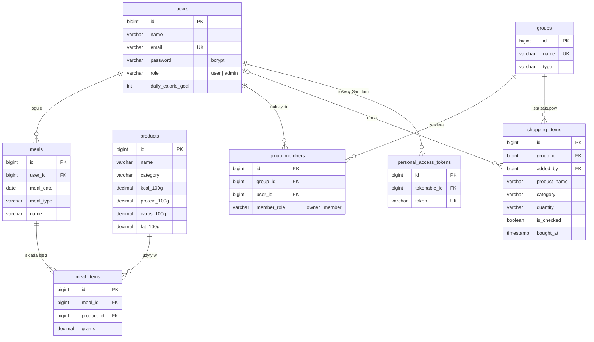

# MealCore 🍽️

**MealCore** to aplikacja do śledzenia kalorii i posiłków. Backend to REST API w **Laravelu** z bazą **PostgreSQL**, uruchamiane w Docker Compose. Projekt zaliczeniowy z przedmiotu *Zaawansowane Technologie Programowania Aplikacji Internetowych*.

Użytkownik zapisuje posiłki z gramaturą produktów, a API liczy kalorie i makroskładniki oraz pokazuje, ile zostało do dziennego celu. Użytkownicy tworzą grupy (rodzina, współlokatorzy, biuro) ze wspólną listą zakupów, a administrator zarządza bazą produktów i kontami.

---

## Stos technologiczny

| Warstwa             | Technologia                                           |
| ------------------- | ----------------------------------------------------- |
| Backend / REST API  | PHP 8.4, Laravel 13                                   |
| Baza danych         | PostgreSQL 16 (osobny kontener)                       |
| Uwierzytelnianie    | Laravel Sanctum (tokeny Bearer)                       |
| Dokumentacja API    | Scribe (OpenAPI 3 + strona `/docs`)                   |
| Testy               | PHPUnit (testy jednostkowe + integracyjne REST API)   |
| Serwer WWW          | nginx + PHP-FPM                                       |
| Konteneryzacja      | Docker Compose (`app` · `nginx` · `db`)               |

---

## Uruchomienie (Docker)

Wymagany jest tylko **Docker Desktop**. PHP i Composer działają w kontenerze.

```bash
git clone https://github.com/AnimaMnie/MealCore.git
cd MealCore

# 1. Konfiguracja – skopiuj plik i ustaw hasło do bazy (DB_PASSWORD)
cp .env.example .env

# 2. Kontenery
docker compose up -d --build

# 3. Zależności, klucz aplikacji, uprawnienia
docker compose exec app composer install
docker compose exec app php artisan key:generate
docker compose exec app chmod -R 777 storage bootstrap/cache

# 4. Baza danych: migracje + dane demo
docker compose exec app php artisan migrate --seed
```

Na Windows w kroku 1 użyj `copy .env.example .env`.

| Usługa              | Adres                                    |
| ------------------- | ---------------------------------------- |
| REST API            | http://localhost:8080/api                |
| Dokumentacja API    | http://localhost:8080/docs               |
| PostgreSQL          | localhost:5433 (host) / `db:5432` (sieć Dockera) |

### Konta demo

| Rola  | E-mail              | Hasło      |
| ----- | ------------------- | ---------- |
| admin | admin@mealcore.com  | `password` |
| user  | alex@mealcore.com   | `password` |

### Testy

```bash
docker compose exec app php artisan test
```

Testy działają na osobnej bazie PostgreSQL `mealcore_test`, którą kontener `db` tworzy przy pierwszym starcie (`docker/postgres/create-test-db.sql`), więc nie kasują danych demo. Jest 10 testów jednostkowych (`tests/Unit`) i 12 integracyjnych REST API (`tests/Feature`).

---

## Funkcje

**Autoryzacja**: rejestracja i logowanie zwracają token Bearer (Sanctum), wylogowanie unieważnia token. Nowe konto zawsze dostaje rolę `user`.

**Produkty**: baza produktów z wartościami na 100 g, wyszukiwanie po nazwie (`?q=`), filtr kategorii i paginacja. Każdy zalogowany może przeglądać, a dodawać, edytować i usuwać może tylko admin.

**Dziennik posiłków**: posiłki w typach `breakfast`, `second_breakfast`, `lunch`, `dinner`, `snack`, `supper`, złożone z produktów z gramaturą. API liczy kcal, białko, węglowodany i tłuszcze dla każdej pozycji i całego posiłku. Endpoint `/api/meals/summary` zwraca podsumowanie dnia względem celu kalorycznego (zostało kcal, % celu, przekroczenie). Każdy widzi tylko swoje posiłki.

**Grupy**: twórca grupy zostaje jej właścicielem i dodaje lub usuwa członków po adresie e-mail. Grupę widzą tylko jej członkowie.

**Lista zakupów**: wspólna lista grupy z kategorią i ilością (np. „500 g”). Odhaczenie pozycji zapisuje czas zakupu. Dostęp mają tylko członkowie grupy.

**Panel admina**: lista użytkowników z wyszukiwaniem i paginacją, zmiana roli (`user` / `admin`), usuwanie kont.

### Reguły biznesowe

- Nie można usunąć produktu użytego w zapisanym posiłku (**409**).
- Nie można zapisać posiłku z przyszłą datą (**422**).
- Nazwa grupy musi być unikalna, bez względu na wielkość liter (**409**).
- Nie można dodać tej samej osoby do grupy dwa razy, a grupa ma limit 10 członków (**409**).
- Nie można usunąć właściciela z grupy (**409**).
- Ten sam niekupiony produkt nie może być dwa razy na liście zakupów (**409**).
- Admin nie może usunąć własnego konta ani odebrać sobie uprawnień (**409**).

---

## Role i uprawnienia

| Rola    | Uprawnienia                                                                 |
| ------- | --------------------------------------------------------------------------- |
| *user*  | własne posiłki i podsumowania, przeglądanie produktów, swoje grupy i ich listy zakupów |
| *admin* | to co user + dodawanie, edycja i usuwanie produktów + panel `/api/admin/*`  |

- **Authentication**: middleware `auth:sanctum`. Brak lub zły token daje **401**.
- **Authorization**:
  - polityki (`ProductPolicy`, `MealPolicy`, `GroupPolicy`, `ShoppingItemPolicy`) podpięte na trasach przez `->can(...)`,
  - middleware `admin` dla panelu admina.
  - Brak uprawnień daje **403**.

---

## Architektura

```
routes/api.php                → trasy REST + middleware (auth, role, polityki)
app/
 ├─ Http/
 │   ├─ Controllers/Api/      → warstwa HTTP: przyjmuje request, woła serwis, zwraca Resource
 │   ├─ Requests/             → walidacja danych wejściowych (Form Requests)
 │   ├─ Resources/            → DTO – format odpowiedzi oddzielony od modelu bazy
 │   └─ Middleware/           → EnsureUserIsAdmin (rola admin)
 ├─ Services/                 → logika biznesowa i reguły (ProductService, MealService,
 │                              GroupService, ShoppingListService, UserManagementService,
 │                              AuthService, NutritionCalculator)
 ├─ Policies/                 → authorization na poziomie zasobów
 ├─ Models/                   → modele Eloquent + relacje (dostęp do danych)
 └─ Exceptions/               → BusinessRuleException (naruszenie reguły biznesowej)
bootstrap/app.php             → globalna obsługa błędów (JSON: 401, 403, 404, 409, 422)
database/
 ├─ migrations/               → migracje schematu bazy
 ├─ seeders/                  → dane demo
 └─ factories/                → fabryki do testów
lang/pl/                      → polskie komunikaty walidacji i błędów
tests/Unit, tests/Feature     → testy jednostkowe i integracyjne
docs/                         → ERD, specyfikacja OpenAPI, kolekcja Postmana
docker/, docker-compose.yml   → kontenery app (PHP-FPM), nginx, db (PostgreSQL)
```

**Przepływ requestu**: `nginx → public/index.php → routes/api.php → middleware (auth:sanctum, can / admin) → Form Request (walidacja) → Controller → Service (reguły biznesowe) → Model Eloquent → PostgreSQL → Resource (DTO) → JSON`.

Konfiguracja jest w `.env`. Hasła i klucze nie trafiają do repozytorium (`.env` jest w `.gitignore`), a `.env.example` zawiera tylko nazwy zmiennych.

---

## Baza danych (ERD)

Diagram jest też w pliku `docs/ERD.mermaid`. Schemat tworzą migracje w `database/migrations`.



---

## Dokumentacja REST API

Pełna, interaktywna dokumentacja (z opcją „Try it out”) jest pod **http://localhost:8080/docs**. Specyfikacja OpenAPI jest w `docs/openapi.yaml`, a gotowa kolekcja do Postmana w `docs/postman_collection.json`. Po zmianach w API dokumentację odświeżysz komendą `docker compose exec app php artisan scribe:generate`.

Wszystkie endpointy poza rejestracją i logowaniem wymagają nagłówka `Authorization: Bearer {TOKEN}`.

| Metoda | Endpoint | Opis | Dostęp |
| ------ | -------- | ---- | ------ |
| POST   | `/api/auth/register` | rejestracja, zwraca token | publiczny |
| POST   | `/api/auth/login` | logowanie, zwraca token | publiczny |
| POST   | `/api/auth/logout` | wylogowanie (usuwa token) | zalogowany |
| GET    | `/api/auth/me` | dane zalogowanego użytkownika | zalogowany |
| GET    | `/api/products?q=&category=&per_page=` | lista produktów (wyszukiwanie, filtr, paginacja) | zalogowany |
| GET    | `/api/products/{id}` | szczegóły produktu | zalogowany |
| POST   | `/api/products` | dodanie produktu | admin |
| PUT/PATCH | `/api/products/{id}` | edycja produktu | admin |
| DELETE | `/api/products/{id}` | usunięcie produktu | admin |
| GET    | `/api/meals?date=&meal_type=&per_page=` | moje posiłki z wyliczonymi kcal i makro | zalogowany |
| GET    | `/api/meals/summary?date=` | podsumowanie dnia względem celu | zalogowany |
| POST   | `/api/meals` | dodanie posiłku z pozycjami | zalogowany |
| GET    | `/api/meals/{id}` | szczegóły posiłku | właściciel |
| PUT/PATCH | `/api/meals/{id}` | edycja posiłku | właściciel |
| DELETE | `/api/meals/{id}` | usunięcie posiłku | właściciel |
| GET    | `/api/groups` | moje grupy | zalogowany |
| POST   | `/api/groups` | nowa grupa (twórca = właściciel) | zalogowany |
| GET    | `/api/groups/{id}` | grupa z członkami | członek |
| DELETE | `/api/groups/{id}` | usunięcie grupy | właściciel |
| POST   | `/api/groups/{id}/members` | dodanie członka po e-mailu | właściciel |
| DELETE | `/api/groups/{id}/members/{userId}` | usunięcie członka | właściciel |
| GET    | `/api/groups/{id}/shopping-items?checked=` | lista zakupów grupy | członek |
| POST   | `/api/groups/{id}/shopping-items` | dodanie pozycji | członek |
| PATCH  | `/api/shopping-items/{id}` | edycja / odhaczenie jako kupione | członek |
| DELETE | `/api/shopping-items/{id}` | usunięcie pozycji | członek |
| GET    | `/api/admin/users?q=&per_page=` | lista użytkowników | admin |
| PATCH  | `/api/admin/users/{id}/role` | zmiana roli | admin |
| DELETE | `/api/admin/users/{id}` | usunięcie konta | admin |

### Kody odpowiedzi

| Kod | Kiedy |
| --- | ----- |
| 200 / 201 / 204 | sukces / utworzono zasób / usunięto |
| 401 | brak lub nieprawidłowy token |
| 403 | brak uprawnień (rola lub cudzy zasób) |
| 404 | zasób nie istnieje |
| 409 | naruszenie reguły biznesowej |
| 422 | błąd walidacji (pole `errors` z listą błędów) |
